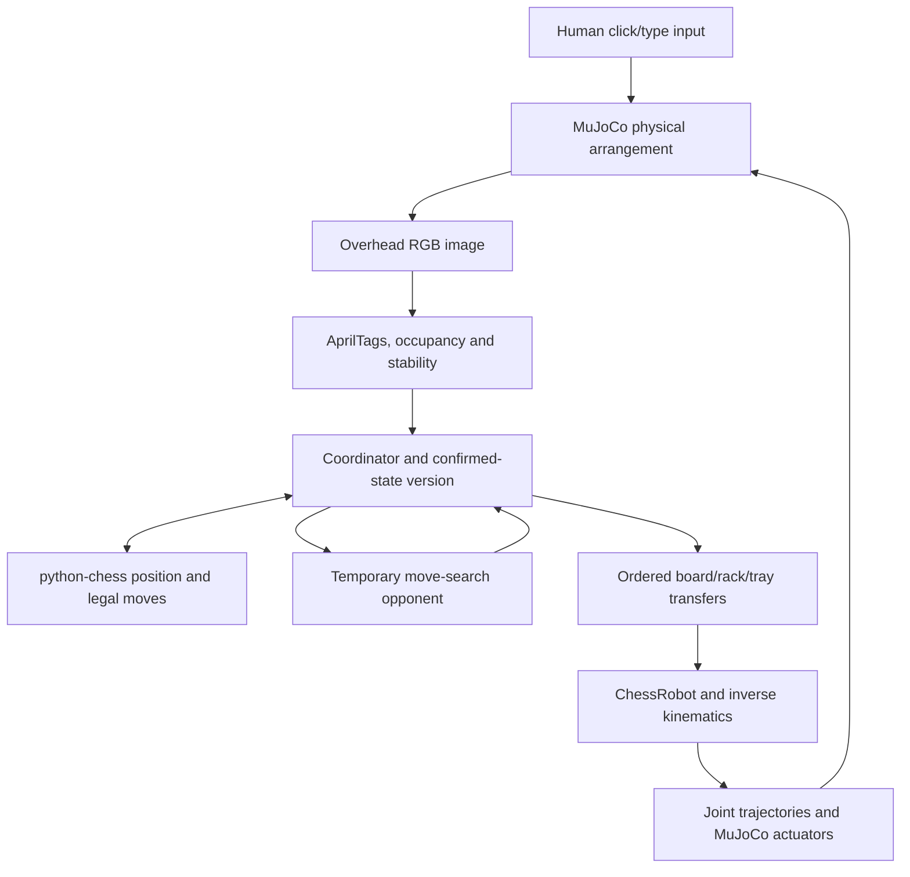

# Ai-Gambit: robotic chess in MuJoCo

Connect 4 has a separate [perception simulation and run guide](connect_4_perception/README.md),
with a front RGB camera, visual fault scenarios, verified virtual drops and tested
ROS 2 Humble perception transport. Connect 4 arm motion remains pending. The
status and instructions below describe the chess system.

Ai-Gambit simulates an SO-101 arm moving chess pieces and uses an overhead RGB
camera to observe the board, promotion rack and capture storage. You can play
White against the arm, inspect perception experiments, or run the motion demo.

**The current chess opponent is a temporary placeholder.** It uses python-chess
for the rules and a small Python search for choosing moves. The team's custom
chess engine has not been connected yet.

**Full ROS 2 integration is still pending.** The working Windows game uses direct
Python calls into MuJoCo. ROS perception messages, services, TF2 publishing and a
simulated camera publisher have been prepared, but have not been runtime-validated
in ROS Humble. Arm movement currently uses neither ROS 2 nor MoveIt 2 nor
ros2_control.

## Contents

- [Current status](#current-status)
- [Windows setup](#windows-setup)
- [Run the different modes](#run-the-different-modes)
- [Play against the arm](#play-against-the-arm)
- [How the current system fits together](#how-the-current-system-fits-together)
- [Simulation and movement](#simulation-and-movement)
- [How perception works](#how-perception-works)
- [Coordinates and configuration](#coordinates-and-configuration)
- [Move acceptance and special cases](#move-acceptance-and-special-cases)
- [Promotion and storage inventory](#promotion-and-storage-inventory)
- [Temporary chess engine](#temporary-chess-engine)
- [Visual experiments and automated tests](#visual-experiments-and-automated-tests)
- [ROS 2 status and pending integration](#ros-2-status-and-pending-integration)
- [Limits of the current implementation](#limits-of-the-current-implementation)
- [Code map](#code-map)
- [Troubleshooting](#troubleshooting)

The [perception guide](so101_simulation/PERCEPTION.md) contains additional ROS
build commands, interface definitions and real-camera calibration instructions.

## Current status

| Component | What exists now | Status |
| --- | --- | --- |
| MuJoCo scene | SO-101 arm, chessboard, 32 board pieces, cameras and mesh assets | Working in Windows simulation |
| Motion | Inverse kinematics, joint trajectories, grasp/transfer stages, captures, parking and viewer pacing | Working with simplified piece carrying |
| RGB perception | AprilTag localization, board rectification, board/rack/tray occupancy, offsets, stability and freshness checks | Implemented and tested in controlled rendered scenes |
| Game coordination | Legal-outcome comparison, inventory tracking, baseline versions and verification before committing a turn | Working through direct Python calls |
| Playing mode | Click/type White moves; arm animates Black replies; camera verifies both | Working in Windows simulation |
| Chess opponent | Small negamax search using python-chess rules | **Temporary placeholder; custom engine integration pending** |
| ROS perception transport | Image/CameraInfo subscriptions, typed observations, services, watchdog and TF2 | Code prepared; ROS build/runtime validation pending |
| ROS movement and game orchestration | ROS actions/nodes connecting coordinator, controller and simulation | **Pending** |
| MoveIt 2 / ros2_control | Planning scene, trajectory execution and hardware interfaces | **Pending** |
| Real robot and camera | Measured calibration, realistic grasp validation and hardware execution | Pending |

## Windows setup

Open PowerShell in the repository root. Create an environment if one does not
already exist, then install the project dependencies:

```powershell
# First-time environment creation only.
py -3.12 -m venv .venv

# Also use this command when updating an existing environment.
.\.venv\Scripts\python.exe -m pip install -r .\so101_simulation\requirements.txt
```

The commands below explicitly use this environment, so PowerShell activation is
optional. Your editor must also use `.venv\Scripts\python.exe` when running files.

| Dependency | Purpose |
| --- | --- |
| MuJoCo | Physics, robot model, rendering and 3D viewer |
| NumPy | Coordinates, kinematics, transforms and image-array calculations |
| OpenCV | AprilTags, image processing and camera/occupancy windows |
| GLFW | Viewer/window support |
| python-chess | Chess position, legal moves, special moves and game outcomes |
| pytest | Automated perception contract and geometry tests |

Native Windows play does not require ROS, a separate engine executable, or an
internet connection after installing dependencies.

## Run the different modes

All commands in this section run from the repository root.

| Mode | Entry point | Camera perception used? |
| --- | --- | --- |
| Play against the arm | `so101_simulation/play_chess.py` | Yes, before actions and for final verification |
| Perception experiments | `so101_simulation/run_perception.py` | Yes, on rendered MuJoCo images |
| Original chess motion demo | `so101_simulation/run_simulation.py` | No; uses simulator piece positions directly |
| Original arm-only panning demo | `launch_basic_arm_spawn.py` | Displays a camera feed; no chess perception/game loop |
| Optional ROS camera source | `so101_simulation/publish_camera.py` | Publishes sensor input for the separate ROS perception node |

### Play or inspect perception

```powershell
# Play White against the arm.
.\so101_simulation\play_chess.cmd

# Step through before/after perception experiments.
.\so101_simulation\run_perception.cmd

# Equivalent direct Python commands.
.\.venv\Scripts\python.exe .\so101_simulation\play_chess.py
.\.venv\Scripts\python.exe .\so101_simulation\run_perception.py
```

The `.cmd` launchers use the project environment and set their own working
directory. They can also be opened directly from File Explorer.

### Run the chess motion demo

```powershell
.\.venv\Scripts\python.exe .\so101_simulation\run_simulation.py

# Choose the scripted sequence explicitly.
.\.venv\Scripts\python.exe .\so101_simulation\run_simulation.py --moves e2e4 d7d5 g1f3 e4d5

# Lower the viewer update rate and disable viewer shadows/reflections.
.\.venv\Scripts\python.exe .\so101_simulation\run_simulation.py --fps 30 --low-graphics

# Execute without opening the viewer.
.\.venv\Scripts\python.exe .\so101_simulation\run_simulation.py --no-viewer
```

This demo defaults to `e2e4`, `d7d5`, `g1f3`, `e4d5`. It does not provide an
interactive terminal move prompt or a `--demo` flag. Use playing mode for a game.
It opens the 3D viewer; the separate overhead/occupancy windows belong to playing
and perception-experiment modes.

### Keep the original arm-only example

```powershell
.\.venv\Scripts\python.exe .\launch_basic_arm_spawn.py
```

This earlier example loads `simulation/scene.xml`, pans the shoulder with a sine
signal and displays its `top` camera window. Run it from the repository root:
its original scene path is relative to the working directory. Its model and
calibration notes remain in [simulation/README.md](simulation/README.md).

## Play against the arm

Playing mode opens three windows: the MuJoCo 3D viewer, the overhead camera, and
the measured occupancy grid. The human plays White and the arm plays Black.

1. In the occupancy window, click the source and destination squares.
2. Press Enter. Alternatively, type UCI notation such as `e2e4` and press Enter.
3. The virtual human action places the pieces in the simulation. Captures remove
   the target piece; castling moves the rook as well as the king.
4. The camera collects fresh observations, and the rules component compares the
   resulting occupancy against all legal next positions.
5. The coordinator verifies the board and affected inventories, then commits the
   human turn. The temporary opponent chooses a Black move.
6. The arm executes its reply, returns clear of the camera, and waits for another
   fresh, stable observation. The Black turn is committed only after verification.

The click/type interface is a virtual hand. It does not reconstruct human finger
motion or require dragging pieces with MuJoCo mouse perturbations. Inputs are
checked for legality before arranging that virtual human action. The resulting
camera observation is still checked independently before committing the turn.

| Control | Behaviour |
| --- | --- |
| Two clicks, then Enter | Select and submit source/destination squares |
| Type a UCI move, then Enter | Submit a move such as `g1f3` |
| Promotion suffix | Append `q`, `r`, `b` or `n`, for example `a7a8q` |
| Backspace | Edit the input |
| Escape | Exit |
| Q with empty input | Exit |
| R with empty input | Reload the confirmed FEN and rebuild inventory after a mismatch |

Reloading is an explicit simulation reset. It does not claim to recover the
identities of an uncertain physical arrangement. A failed verification pauses
play; the coordinator does not silently advance the game or repeatedly retry a
pick at an uncertain location.

Useful playing-mode options:

```powershell
# Watch a short visual replay of scripted White inputs and generated Black replies.
.\.venv\Scripts\python.exe .\so101_simulation\play_chess.py --demo

# Scripted game with camera verification and animated arm control, without windows.
.\.venv\Scripts\python.exe .\so101_simulation\play_chess.py --headless --moves e2e4 g1f3

# Instant robot transfers for faster camera/coordinator experiments.
.\.venv\Scripts\python.exe .\so101_simulation\play_chess.py --no-animation

# Start from a valid FEN with White to move.
.\.venv\Scripts\python.exe .\so101_simulation\play_chess.py --fen "r3k2r/8/8/8/8/8/8/R3K2R w KQkq - 0 1"
```

`--moves` supplies White inputs for scripted/headless replay; Black replies are
chosen by the opponent. `--depth` accepts 1, 2 or 3 and defaults to 2. `--speed`
adjusts animated playback pacing. `--exit-after-demo` closes a completed visual
replay and is useful for GUI smoke checks. `--fps` and `--low-graphics` are options
of the motion demo, not options of `play_chess.py`.

## How the current system fits together

The following arrows are direct Python calls in the working Windows mode:



Responsibilities are deliberately separate:

| Component | Owns |
| --- | --- |
| Perception | Physical occupancy, geometry, uncertainty, temporal stability and observation timestamps |
| Rules/engine | Piece identities, legal moves, side to move, castling/en-passant rights and promotion choice |
| Coordinator | Baselines, game-state versions, pending operations, inventory and when a result may be committed |
| Control | Approach/placement targets, inverse kinematics, gripper commands and joint trajectories |
| Simulation adapter | Camera rendering, scene construction, virtual human actions and known test arrangements |

The RGB detector does not import MuJoCo or read piece body positions to classify
squares. The simulation adapter necessarily uses simulator state to arrange/reset
scenes, attach known bodies during simplified control, and score tests. Known
fiducial geometry and camera calibration are legitimate inputs to localization.
The older motion-only demo uses simulator occupancy directly and should not be
used as evidence of camera perception.

## Simulation and movement

### Scenes, models and cameras

`so101_simulation/chess_world.xml` contains the chess scene: five arm joints plus
the gripper joint, six actuators, a board centred at base position `[0.25, 0, 0]`,
30 mm squares and a board surface at Z = 10 mm. The 32 board pieces use mesh
visuals and simpler collision geometry. Physics uses a 2 ms timestep, the
`implicitfast` integrator and up to 50 solver iterations.

The perception adapter extends that original XML instead of maintaining another
hand-written robot model. It generates AprilTag textures, fiducial fixtures, the
32-slot promotion rack and 48-slot capture/retirement storage. Generated scene
files and the empty-workspace photograph live under `perception_assets/`.

| Setting | Motion-only scene | Perception/playing scene |
| --- | --- | --- |
| Overhead camera position, metres | `[0.25, 0, 0.65]` | `[0.27, 0, 0.82]` |
| Vertical field of view | 55 degrees | 48 degrees |
| Perception camera render size | Not used by this runner | 1280 x 960 RGB |
| Rectified board image | Not used | 800 x 800 |
| Promotion/capture fixtures | Original scene | Generated extended workspace |

The original arm-only `simulation/` model is retained separately. Its calibration
and joint ranges are not interchangeable with the chess model's simulation
ranges, and the latter have not been validated as hardware limits.

### From a move to joint commands

The coordinator expands a chess move into transfers. A capture removes the
captured piece first; castling adds a rook transfer; promotion adds retirement of
the pawn and retrieval of a configured spare piece.

For animated playing-mode actions, source targets use the camera-estimated board
transform and approximate centre offsets. Rack and tray targets use their
observed fixture transforms and known slot layouts. Known piece identities/body
handles come from the coordinator's inventory. Approach and grasp targets are
checked for IK reachability before starting the animated operation sequence.

`ik_solver.py` calculates joint angles that bring the gripper's `pinch_site` to
the target. It uses a damped Jacobian update and a secondary preference for a
downward gripper orientation, clips to model joint limits, and reports its
residual error. Its default position tolerance is 0.5 mm. This is a kinematics
check, not a full collision-free trajectory proof.

`chess_robot.py` and `motion_planner.py` then execute approach, vertical descent,
clamp, lift, transit at clearance height, placement, release, retract and return.
The clearance target is 130 mm above the base plane. Joint setpoints follow a
cosine interpolation so segment starts and ends are gradual. The perception
adapter returns the arm through HOME and uses a settled PARK pose for the final
camera observation.

**Piece carrying is simplified:** the selected piece is attached kinematically
to the pinch site during transport and placed at its target before release.
Collision masks isolate bystanders during transfer. Visual-only meshes and
hidden test pieces remain disabled as collision objects. These mechanisms make
the camera/coordinator prototype repeatable; they do not validate frictional
grasping or collision avoidance on the real arm.

### Path and performance fixes

Relative scene paths passed to `ChessRobot` are resolved beside its Python file.
This fixes launching the chess runner from the repository root or an editor that
uses a different current directory. Explicit absolute scene paths remain usable.

Physics remains at 500 Hz, while the viewer is synchronized approximately 60
times per second by default. The old loop synchronized and slept after every
physics step. The updated loop batches display updates and sleeps only for the
remaining time until a playback deadline. The idle viewer and final settling
also use paced batches. Closing the viewer stops execution; display errors no
longer restart the entire move list on a partly changed board.

`--fps 30 --low-graphics` reduces display updates and disables viewer shadows and
reflections in the motion demo. It leaves physics and offscreen camera settings
unchanged. In headless mode, physics executes without viewer pacing. Camera
processing and engine thinking still take real computation time; display targets
are not guaranteed frame rates on every GPU or computer.

## How perception works

The shared detector is
[`perception.py`](perception_ws/src/ai_gambit_perception/ai_gambit_perception/perception.py).
It contains the processing stages in one module, with ROS transport and
simulation-specific work kept outside it.

1. **Check the frame.** Reject missing images, wrong dimensions, stale/future
   timestamps and out-of-order frames. The configured maximum age is one second.
2. **Undistort the image.** Use camera intrinsics and lens-distortion coefficients.
   Simulation uses an ideal pinhole model derived from its camera settings.
3. **Detect tags.** OpenCV detects AprilTag 36h11 IDs. Board tags are 0-3, rack
   tags 4-7, and tray tags 8-11. Each fixture needs at least two usable tags.
4. **Localize each fixture independently.** RANSAC rejects inconsistent corners;
   solvePnP estimates the fixture pose. Reprojection error and unexpected position
   or orientation changes invalidate calibration. A hidden rack does not borrow
   a valid board pose to claim that its own occupancy is known.
5. **Rectify the workspace.** Warp the board to 800 x 800 pixels, giving 100 x
   100 pixels per square. Separate views cover the rack, capture trays and gaps
   around the fixtures.
6. **Compare against an empty reference.** The simulation deliberately renders an
   empty workspace, then restores the pieces. It does not learn the reference
   from an occupied starting board. Hardware requires its own empty photograph.
7. **Classify foreground.** Robust background normalization handles moderate
   exposure changes. Image differences, morphology and connected components
   identify compact foreground near square/slot centres. Thin grid artifacts are
   removed without cutting real pieces at square boundaries. Dense storage uses
   local slot measurements while still rejecting large obstructions.
8. **Represent uncertainty.** Each square/slot has occupancy and confidence.
   Oversized components, off-centre pieces, stray objects and obscured regions
   inhibit acceptance. The board also receives approximate visual centre offsets.
9. **Wait for stability.** Multiple fresh frames must agree. The default is three
   consistent frames; snapshot collection normally captures four. Image changes
   are checked across all monitored fixtures, not only the 64 occupancy bits.
10. **Verify the intended result.** Compare the fresh observation against the
    expected board and requested inventories, with the correct baseline version
    and a timestamp after the operation began.

Occupancy is `0 = EMPTY`, `1 = OCCUPIED`, `255 = UNKNOWN`. Unknown is never silently
treated as empty or used as a wildcard to accept a legal move. Confidence values
are heuristic quality scores, not statistically calibrated probabilities.

| Observation/status | Meaning and response |
| --- | --- |
| `INITIALIZING` | Configuration/reference is not ready; do not start a turn |
| `MOVING` | Insufficient consistent frames; wait |
| `READY` | Clear, stable physical observation is available; still compare it with the expected game state |
| `OCCLUDED` | Unknown object, invalid placement or obstruction; wait/correct the scene |
| `CALIBRATION_INVALID` | Insufficient reliable tags, poor geometry or shifted fixture/camera; validate and relocalize |
| `CAMERA_FAILURE` | Missing, invalid or stale camera data; do not authorize a new action |
| `ROBOT_EXECUTING` | Intermediate robot arrangement cannot be committed |
| `BOARD_MISMATCH` | ROS verification/baseline failure status; the direct Python coordinator reports the mismatch and pauses |

`READY` does not mean that a requested move succeeded. A piece on the wrong square
can produce an accurate, READY occupancy image that correctly fails verification.
During animated play the camera window is refreshed, but final acceptance waits
until the arm is parked and a new stable snapshot is collected. The Windows UI
does not provide continuous protective hand detection throughout a trajectory.

## Coordinates and configuration

All board arrays use `a1, b1, ..., h1, a2, ..., h8`, with
`index = rank_index * 8 + file_index`. File/rank indices start at zero. The
rectified display puts rank 8 at the top and file a at the left.

The board frame starts at the outer corner beside a1:

```text
board X: file a toward h
board Y: rank 1 toward 8
board Z: upward from the playing surface

square centre in board coordinates:
    x = (file_index + 0.5) * 0.030 metres
    y = (rank_index + 0.5) * 0.030 metres
```

In the current workspace, the board origin in base coordinates is
`[0.13, 0.12, 0.01]`. Board X points along base -Y and board Y along base +X.
For example, a1 is at base `[0.145, 0.105, 0.01]` on the board surface.

The 4 x 4 transform equation is:

```text
T_base_board = T_base_camera_optical * T_camera_optical_board
```

Here `T_base_camera_optical` maps camera-optical coordinates into `base_link`;
`T_camera_optical_board` maps board coordinates into the camera optical frame.
Multiplying them maps a board point into the robot base frame. The same approach
is used for the promotion rack and capture tray.

The main settings are in
[`workspace.json`](perception_ws/src/ai_gambit_perception/ai_gambit_perception/workspace.json):

| Setting | Current default | Purpose |
| --- | --- | --- |
| `image_width`, `image_height` | 1280, 960 | Calibrated input/render size |
| `camera_position`, `camera_fovy_degrees` | `[0.27, 0, 0.82]`, 48 | Simulated overhead camera |
| `board_pixels` | 800 | Rectified board image size |
| `marker_size` | 0.026 m | Black marker width, excluding the white quiet zone |
| `stable_frames` | 3 | Required consistent observations |
| `max_frame_age` | 1 second | Freshness limit |
| `max_reprojection_error` | 2.5 pixels | Localization quality threshold |
| `max_pose_shift` | 0.005 m | Fixed-fixture position-change limit |
| `max_pose_angle_degrees` | 3 | Fixed-fixture orientation-change limit |
| `max_center_offset` | 0.009 m | Visual centring tolerance used by the detector |
| `difference_threshold` | 30 intensity levels | Foreground difference threshold |
| `rack_types` | Q/R/B/N repeated in each colour row | Coordinator's labelled spare-piece assignments |

These values describe the tested workspace and are not hardware calibration
results. Board dimensions, slot layout and pixel-dependent detection sizes also
appear in the scene/control code. Editing a geometry key alone does not rescale
the whole system; update the related geometry and rerun the rendered tests.

## Move acceptance and special cases

`Coordinator.baseline()` first compares a stable camera observation with the
confirmed board and inventories. An invalid baseline clears previous
authorization. Every confirmed game state has a version number.

For a final observation, the rules component copies the confirmed chess board,
simulates each legal move and compares the resulting complete occupancy arrays.
The search does not mutate the confirmed board. Zero matches means mismatch;
several matches require explicit disambiguation. Low confidence and unknown
squares prevent interpretation.

`Coordinator.accept()` verifies legality, board occupancy, requested rack/tray
state, baseline version, a newer observation ID and a timestamp after the action
started. Only then does it push the move and update inventory/version. A failed
observation cannot silently advance the game.

| Situation | What is accounted for |
| --- | --- |
| Normal move | Source becomes empty and destination occupied |
| Capture | Source becomes empty; destination stays occupied; captured-piece storage must change as expected |
| Ambiguous capture | Several legal captures can produce the same binary occupancy; explicit destination selection is required |
| Castling | Both king and rook transfers are included; a stable king-only intermediate arrangement is rejected |
| En passant | Captured pawn is removed from its own square, not the destination square |
| Promotion | Explicit Q/R/B/N selection, known spare slot, pawn retirement, replacement placement and inventory checks |
| Capture promotion | Capture storage plus pawn retirement and spare removal are all included |
| Touch and return | Final unchanged occupancy is not invented into a new move |
| Failed/wrong placement | Final observation fails the expected result; no logical commit |
| Another piece displaced | Complete occupancy comparison catches changes beyond the requested source/destination |
| Missing inventory/full storage | Refuse to start an operation that lacks the required spare or destination capacity |
| Hand/arm/object present | Block acceptance of an obstructed observation |
| Stale/out-of-order observation | Reject it rather than reuse pre-action evidence |
| Identity swap with unchanged occupancy | Explicit V1 observability limit; cannot prove piece identity from binary occupancy |

## Promotion and storage inventory

The promotion rack is a 2 x 16 matrix. Indices 0-15 are the White row; 16-31 are
the Black row. Defaults repeat queen, rook, bishop, knight four times per row.
`rack_types` can be changed to reserve more of a requested type. If all matching
spares are used, the action pauses rather than silently selecting another type.

Spare pieces are compact cylinder proxies. A proxy's assigned chess identity is
known from the labelled loading arrangement; the detector does not distinguish
its type from appearance. A wrongly loaded type with the same occupancy cannot
be detected by this V1 system.

Capture/retirement storage has 48 slots: indices 0-23 for White pieces and 24-47
for Black, three rows of eight per colour. The White side uses negative base Y;
the Black side uses positive base Y. Storage serves both captured pieces and
retired promotion pawns. Its capacity allows 23 stored physical pieces per colour
with the king remaining on the board, including eight used promotion replacements.
The dense-storage experiment places 46 pieces in storage and leaves two kings
on the board. Actual promotion choices remain limited by the loaded spare types.

Pending inventories are committed only with the verified move. The controller
checks availability and endpoint/approach reachability before starting the
animated transfer sequence. Reinitializing a FEN with extra promoted pieces uses
the configured spare inventory where original piece models are insufficient.

## Temporary chess engine

**The opponent in `chess_game.py` is a temporary placeholder for testing the
perception, coordinator and robot loop. It is not the team's final chess engine.**

`python-chess` maintains the rules and legal game position. The local
`choose_move(board, depth)` function chooses an opponent move using deterministic
negamax search with alpha-beta pruning. Its evaluation uses piece material and a
small central-square bonus. Material values are pawn 100, knight 320, bishop 330,
rook 500 and queen 900; mate/draw outcomes are handled separately.

The default depth is two plies: one arm move and one possible human reply.
`--depth 1`, `2` or `3` changes that horizon. This is a basic testing opponent;
search depth and passing simulation tests are not measures of competitive strength.

The replacement point is `choose_move()` in
[`chess_game.py`](so101_simulation/chess_game.py). A future engine adapter should
take the confirmed position and return a legal move, including promotion suffixes
where needed. It must preserve the coordinator's pending-versus-confirmed-state
contract: choosing a move must not commit it before physical verification.

Perception publishes occupancy rather than inventing a FEN or continuously
classifying all twelve piece/color combinations. The engine/coordinator owns
identities and rules throughout.

## Visual experiments and automated tests

### Inspect the camera evidence

```powershell
# Run every case and write the gallery without opening windows.
.\.venv\Scripts\python.exe .\so101_simulation\run_perception.py --headless
Start-Process .\so101_simulation\perception_results\index.html

# Inspect only selected cases, with before/after windows.
.\.venv\Scripts\python.exe .\so101_simulation\run_perception.py --case capture partial_castle hand_on_board
```

In interactive experiments, Space/N advances from BEFORE to AFTER and then to
the next case; Escape stops. Each case saves `before.png`, `after.png`,
`occupancy.png` and `result.json`. `index.html` compares the images, expected
response, observed response, verification result and geometry metrics.
`summary.json` contains the selected run's machine-readable results.

Green outlines mean occupied, grey empty, and orange unknown. A passing failure
case means the system produced the specified refusal/mismatch; it does not mean
the robot successfully completed an intentionally failed action. The report
separates known-square coverage from correct known-square classifications.
Every READY scene in the rendered suite must classify all 64 board squares
correctly against independent simulator ground truth.

Running a subset rewrites the top-level gallery/summary for that subset. It does
not represent a fresh full-suite run. Remove `--case` to regenerate all 56 cases.
Generated outputs are ignored by Git and may not exist in a fresh clone.

### The 56 rendered scenarios

Case names below are accepted by `--case` and are defined in the `CASES` table
in [`run_perception.py`](so101_simulation/run_perception.py).

| Area | Exact scenario names |
| --- | --- |
| Basic observations and moves | `opening`, `normal_move`, `knight_move` |
| Captures | `capture`, `capture_ambiguity`, `capture_storage_missing` |
| Inventory and capacity | `last_white_storage_slot`, `last_black_storage_slot`, `maximum_promotion_storage`, `missing_rack_piece` |
| Castling | `kingside_castle`, `queenside_castle`, `black_kingside_castle`, `black_queenside_castle`, `partial_castle` |
| En passant | `en_passant`, `incomplete_en_passant`, `black_en_passant` |
| Promotion | `promotion_queen`, `promotion_rook`, `promotion_bishop`, `promotion_knight`, `capture_promotion`, `promotion_ambiguous`, `promotion_spare_not_removed` |
| Interaction/observability | `touch_and_return`, `identity_swap_not_observable` |
| Incorrect actions | `illegal_three_square_pawn`, `failed_pickup`, `wrong_square`, `accidental_second_move` |
| Placement | `offset_3mm`, `offset_12mm`, `between_squares`, `toppled_piece` |
| Obstructions | `hand_on_board`, `hand_on_capture_tray`, `object_on_capture_tray`, `foreign_object`, `object_in_workspace_gap`, `arm_blocks_board` |
| Calibration | `one_board_tag_hidden`, `one_corrupted_tag`, `all_board_tags_hidden`, `rack_tags_hidden`, `tray_tags_hidden`, `board_shifted`, `camera_shifted` |
| Sensor quality/timing | `moderate_exposure`, `sensor_noise`, `severe_blur`, `camera_disconnected`, `stale_frame`, `out_of_order_frame` |
| Robot activity | `robot_in_progress`, `actual_arm_move` |

Most experiments arrange a controlled physical before/after state so the image
response can be isolated. `actual_arm_move` also runs an animated arm transfer.
The interactive game and its visual demo provide additional trajectory viewing.
These cases exercise the listed controlled conditions; they do not cover every
possible physical object, lighting condition or arbitrary game history.

### Run automated checks

```powershell
# Perception/rules/coordinator/geometry contracts.
.\.venv\Scripts\python.exe -B -m pytest .\so101_simulation\test_perception.py -q

# Scripted camera-verified human and animated arm turns.
.\.venv\Scripts\python.exe .\so101_simulation\play_chess.py --headless --moves e2e4 g1f3

# GUI replay that closes automatically after one human turn and arm reply.
.\.venv\Scripts\python.exe .\so101_simulation\play_chess.py --demo --exit-after-demo --moves e2e4

# Original motion checks use relative XML paths and run from this folder.
Push-Location .\so101_simulation
..\.venv\Scripts\python.exe -B test_system.py
Pop-Location
```

The contract suite checks legal outcomes and ambiguity, unknown/low-confidence
rejection, freshness, operation timestamps, sequence IDs, baseline versions,
clearing invalid authorization, failed-verification atomicity, one-time commits,
inventory refusal before motion, extra promoted-piece loading, rendered fixture
geometry/orientation, temporal stability and an end-to-end game round trip.

`test_system.py` checks initial stability, IK reachability across 64 squares, the
four scripted moves/capture, final square occupancy and upright bystander pieces.
Do not run unqualified `pytest` across all historical diagnostic scripts; several
are interactive utilities or have top-level simulator code.

### Recorded implementation validation

The completed Windows implementation was validated with:

| Check | Recorded outcome |
| --- | --- |
| Full rendered perception suite | 56/56 expected responses |
| READY scenes in that full run | 37 scenes, each with 64/64 board squares classified correctly |
| Perception contract/geometry suite | 34 tests passed |
| Original motion test suite | Stability, 64-square IK and all four scripted moves/capture passed |
| Scripted game | Two White turns and two animated Black replies camera-verified |
| Animated special-move checks | Castling, en passant and promotion verified |
| Windows GUI replay | 3D viewer, overhead camera and occupancy windows opened; replay completed |
| Opening scene geometry example | Maximum board-corner error about 0.63 mm; mean approximate visual piece-centre error about 2.31 mm |

These are simulation results from the implementation validation, not a promise
that a currently saved subset is a full run or that every future configuration
will pass. Geometry values describe rendered images and the approximate centroid
method; they do not establish physical grasp accuracy or real-camera calibration.

## ROS 2 status and pending integration

**ROS integration is still pending for the complete system.** Launching the
current Windows game does not start ROS nodes or send movement over ROS topics
or actions. The movement path is:

```text
Coordinator -> simulation transfer adapter -> ChessRobot -> IK/MotionPlanner
            -> MuJoCo actuator controls
```

The repository already contains a prepared ROS perception boundary:

| Interface | Prepared implementation |
| --- | --- |
| `/camera/image_raw` | `sensor_msgs/Image` subscription, converted to RGB through cv_bridge |
| `/camera/camera_info` | Camera calibration with dimension, frame and timestamp checks |
| `/coordinator/state` | String state input that inhibits acceptance during robot execution/pause/recovery |
| `/perception/board_observation` | Typed 64-square occupancy, confidence, offsets, timestamp, sequence and validity |
| `/perception/rack_observation` | Typed 32 promotion-slot and 48 capture-slot observations |
| `/perception/status` | Observation/failure state publishing and camera watchdog |
| `/perception/snapshot` | Wait for a fresh stable observation, with operation ID, version, after-time and timeout |
| `/perception/set_baseline` | Compare the scene against the expected versioned board/inventory |
| `/perception/verify` | Fresh post-operation board/inventory verification |
| TF2 | `base_link` to board, promotion-rack and capture-tray frames |
| `publish_camera.py` | Optional MuJoCo RGB/CameraInfo publisher and static camera transforms |

The old `package.xaml` filename was corrected to `package.xml`, the missing ament
resource was added, and `ai_gambit_interfaces` defines the messages/services.
The node uses sensor-data QoS and a multi-thread executor so services can wait
while camera callbacks run. AprilTags are detected in the shared OpenCV core;
an additional apriltag_ros detector is not required by this implementation.

This is prepared transport code, not a completed ROS movement stack. Pending work
includes building/running these packages in Ubuntu/ROS Humble, validating sensor
timing and TF ownership, exposing arm motion through ROS nodes/actions, publishing
joint states, connecting the coordinator/engine, and testing the complete loop.
MoveIt planning-scene and ros2_control integration are also pending.

WSL 2 with Ubuntu 22.04 is the planned Linux environment for ROS 2 Humble work.
Having WSL installed does not convert the existing Python calls into ROS traffic.
Do not assume ROS or its packages are installed just because Ubuntu is present.

```powershell
# Enter the Ubuntu distribution from Windows when working on the pending ROS setup.
wsl -d Ubuntu-22.04
```

The [ROS section of the perception guide](so101_simulation/PERCEPTION.md#ros-2-humble-interface)
contains prerequisite/build commands for testing the prepared perception packages.
Those instructions describe the optional perception path, not an already
integrated ROS-controlled chess game.

## Limits of the current implementation

- **Engine:** the move chooser is temporary; integration of the team's custom
  chess engine remains to be done.
- **ROS:** full game/movement integration and ROS runtime validation remain
  pending. Windows validation does not validate ROS service or controller execution.
- **Identity:** binary occupancy cannot prove which piece occupies a square,
  detect every identity swap or verify a wrongly loaded promotion type.
- **Geometry:** offsets are approximate 2D foreground centroids. Hardware needs
  measured intrinsics, camera-to-base calibration and physical reference-point
  validation. Simulator defaults are not a real-camera calibration.
- **Fixtures:** unexpected board/camera movement invalidates observations. This
  fixed-fixture V1 requires deliberate validation/recalibration before resuming.
- **Grasping:** pieces are carried kinematically and placement is imposed in the
  simulator. Real contact, slip, grasp force and release reliability are unvalidated.
- **Collision planning:** clearance waypoints and contact isolation do not replace
  full-arm collision-aware planning. A MoveIt planning scene has not been connected.
- **Obstructions:** the detector is heuristic and tested against specified cases.
  It does not reconstruct arbitrary obstacle volumes from overhead RGB or provide
  a certified protective stop during motion.
- **Inventory:** a requested spare type can run out. Configured loading and
  controlled slot assignments are required.
- **Simulation:** historical model joint ranges and actuator settings require
  hardware validation before commanding a real arm.

## Code map

| Location | Responsibility |
| --- | --- |
| [so101_simulation/run_simulation.py](so101_simulation/run_simulation.py) | Original scripted chess motion runner |
| [so101_simulation/chess_world.xml](so101_simulation/chess_world.xml) | Base chess/robot MuJoCo scene |
| [so101_simulation/assets/](so101_simulation/assets/) | Arm and chess mesh assets |
| [so101_simulation/chess_coords.py](so101_simulation/chess_coords.py) | Square coordinates, grasp/rest heights, HOME/PARK and storage positions |
| [so101_simulation/ik_solver.py](so101_simulation/ik_solver.py) | Position IK with a downward orientation preference |
| [so101_simulation/motion_planner.py](so101_simulation/motion_planner.py) | Joint interpolation, physics stepping, pacing and simulated attachment |
| [so101_simulation/chess_robot.py](so101_simulation/chess_robot.py) | Multi-stage transfers and original capture/move helper |
| [so101_simulation/perception_sim.py](so101_simulation/perception_sim.py) | Generated fixtures, reusable renderer, virtual actions and transfer adapter |
| [so101_simulation/chess_game.py](so101_simulation/chess_game.py) | Rules adapter, coordinator, occupancy matching and temporary move search |
| [so101_simulation/play_chess.py](so101_simulation/play_chess.py) | Human UI, opponent turns and camera-verified game loop |
| [so101_simulation/run_perception.py](so101_simulation/run_perception.py) | 56 named experiments, independent board scoring and HTML/JSON output |
| [so101_simulation/test_perception.py](so101_simulation/test_perception.py) | Perception/coordinator contracts and rendered geometry tests |
| [so101_simulation/test_system.py](so101_simulation/test_system.py) | Original motion/stability tests |
| [perception.py](perception_ws/src/ai_gambit_perception/ai_gambit_perception/perception.py) | RGB-only detector, stability, baseline and verification logic |
| [workspace.json](perception_ws/src/ai_gambit_perception/ai_gambit_perception/workspace.json) | Workspace calibration, marker layout, thresholds and spare assignments |
| [perception_node.py](perception_ws/src/ai_gambit_perception/ai_gambit_perception/perception_node.py) | Prepared ROS perception transport |
| [ai_gambit_interfaces/](perception_ws/src/ai_gambit_interfaces/) | Typed ROS messages and services |
| [so101_simulation/publish_camera.py](so101_simulation/publish_camera.py) | Prepared ROS simulated-camera source |
| [so101_simulation/PERCEPTION.md](so101_simulation/PERCEPTION.md) | Additional perception, calibration and experimental ROS setup detail |
| [simulation/](simulation/) and [launch_basic_arm_spawn.py](launch_basic_arm_spawn.py) | Earlier arm-only model and panning example |

Generated `perception_assets/` and `perception_results/` are not independent source
implementations. Existing `build/`, `install/` and `log/` directories are generated
workspace artifacts; their presence alone does not show that the new ROS packages
were built or validated.

## Troubleshooting

| Symptom | Check |
| --- | --- |
| `ModuleNotFoundError` | Use the project `.venv` interpreter and install `so101_simulation/requirements.txt` into that environment |
| Cannot find `chess_world.xml` | The updated `ChessRobot` resolves relative paths beside its script; confirm you are running this checkout's code |
| No overhead camera window from `run_simulation.py` | Use `play_chess.py` or `run_perception.py` for the camera/occupancy workflow |
| Motion viewer is slow | Use `--fps 30 --low-graphics` with `run_simulation.py`; the same flags are not accepted by the other runners |
| Game pauses after an observation | Read the status/reason; clear input and use R for an explicit reload of the confirmed FEN if needed |
| Promotion is ambiguous | Enter the complete move including `q`, `r`, `b` or `n`; ensure a configured spare remains available |
| Gallery shows fewer than 56 cases | A selected-case run replaced the summary; rerun `run_perception.py --headless` without `--case` |
| Generated gallery/fixtures are missing in a fresh clone | Run the corresponding simulation/experiment; these artifacts are generated and ignored by Git |
| ROS commands are unavailable in PowerShell | Native Windows play uses direct Python; ROS setup/build/runtime work is still pending in Ubuntu/WSL |

